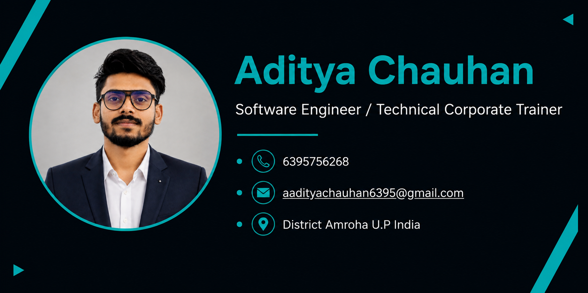

 

  

  <h1>Hi, I'm Aditya Chauhan 👋</h1>
  <h2>Aditya Chauhan Sir | Software Engineer | Data Science Specialist | Corporate Trainer</h2>

  

    <b>Building Technology | Exploring AI | Empowering Future Developers</b>
  

  

    <a href="https://adityasir.in">Personal Website</a> •
    <a href="https://linkedin.com/in/adityachauhan6395">LinkedIn</a> •
    <a href="https://github.com/Aditya-Chauhan-1">GitHub</a>
  

  

   

  
  

---

## 👨‍💻 About Me

Hello! I'm **Aditya Chauhan**, also known professionally as **Aditya Chauhan Sir**.

I am a Computer Science and Engineering graduate from Moradabad Institute of Technology (2024), working across Software Engineering, Data Science, Artificial Intelligence, and Technical Education.

My professional interests combine software development with practical technology training. I enjoy developing applications, exploring machine learning solutions, building AI-powered projects, and helping students understand real-world technologies through hands-on learning.

- 💻 **Software Engineering:** Full Stack Development, MERN Stack, API Development & Integration.
- 📊 **Data Science:** Python, Data Analysis, Data Visualization, and Machine Learning.
- 🤖 **Artificial Intelligence:** AI Fundamentals, NLP, Generative AI, and AI-powered Applications.
- 🎓 **Corporate Training:** Python, Web Development, Data Science, AI, and Machine Learning.
- 🌐 **Web Technologies:** React.js, JavaScript, Node.js, Express.js, MongoDB, HTML5, CSS3, and Tailwind CSS.
- 🚀 **Current Focus:** Building practical AI/ML projects and industry-oriented learning solutions.
- 🤝 **Open To:** Software Engineering opportunities, Corporate Training, Technical Mentoring, and collaborations.

🌐 **Personal Brand:** [Aditya Chauhan Sir – adityasir.in](https://adityasir.in)

---

## 🎯 Professional Expertise

<table>
<tr>
<td width="50%" valign="top">

### 💻 Software Engineering

- Full Stack Web Development
- MERN Stack Development
- Frontend Development
- Backend Development
- REST API Development
- API Integration
- Database Management
- Responsive UI Development

</td>
<td width="50%" valign="top">

### 📊 Data Science & AI

- Python Programming
- Data Analysis
- Data Cleaning & Processing
- Exploratory Data Analysis
- Data Visualization
- Machine Learning
- Natural Language Processing
- AI-powered Applications

</td>
</tr>
<tr>
<td width="50%" valign="top">

### 🎓 Corporate Training

- Python Programming
- Web Development
- Data Science Training
- Artificial Intelligence
- Machine Learning
- Practical Project Development
- Technical Mentoring
- Industry-oriented Learning

</td>
<td width="50%" valign="top">

### 🚀 Development & Collaboration

- Software Architecture Fundamentals
- Requirement Implementation
- Debugging & Problem Solving
- Git & GitHub
- Agile Development
- Team Collaboration
- Technical Documentation
- Continuous Learning

</td>
</tr>
</table>

---

## 🛠️ Technical Skills & Tech Stack

### Programming Languages

  

### Frontend Development

  

### Backend Development & Databases

  

### Data Science & Machine Learning

  

  
  
  
  
  

### Tools & Platforms

  

---

## 🚀 Featured Projects & Development Interests

I enjoy working on practical projects that combine software engineering, automation, data science, and artificial intelligence.

| Area | Project Interests |
|---|---|
| Artificial Intelligence | AI-powered Chatbots, NLP Applications |
| Machine Learning | Predictive Analytics, Classification Models |
| Data Science | Data Analysis & Visualization |
| Web Development | MERN Stack Applications |
| Education Technology | AI-based Learning & Student Projects |
| Backend Development | REST APIs & Database-driven Applications |

---

## 🎓 Teaching & Technical Mentoring

I believe technology becomes more powerful when knowledge is shared.

As a Corporate Trainer and Technical Mentor, I focus on making complex technical concepts easier to understand through practical demonstrations and project-based learning.

**Training Domains:**

- Python Programming
- Full Stack Web Development
- Data Science
- Artificial Intelligence
- Machine Learning
- SQL & Database Fundamentals
- Real-World Project Development

My goal is to help students move beyond theoretical knowledge and develop practical, industry-relevant technical skills.

---

## 📈 GitHub Analytics

  

  

    

  

    

  

---

## 📊 Contribution Activity

  

---

## 🌐 Connect With Me

I'm always interested in connecting with developers, technology professionals, educators, students, and organizations.

  

  

  

  

  

---

## 💡 My Professional Philosophy

> "Learn continuously, build fearlessly, share knowledge, and create technology that makes a difference."

I believe in continuous improvement, practical learning, innovation, and collaboration. My journey is focused on growing as a Software Engineer, Data Science Specialist, and Corporate Trainer while contributing to the technology community.

---

  ### Thanks for Visiting My GitHub Profile! ❤️

  **Aditya Chauhan Sir**

  *Software Engineer | Data Science Specialist | Corporate Trainer*

  <a href="https://adityasir.in">
    <b>Visit My Website → adityasir.in</b>
  </a>

    

  

